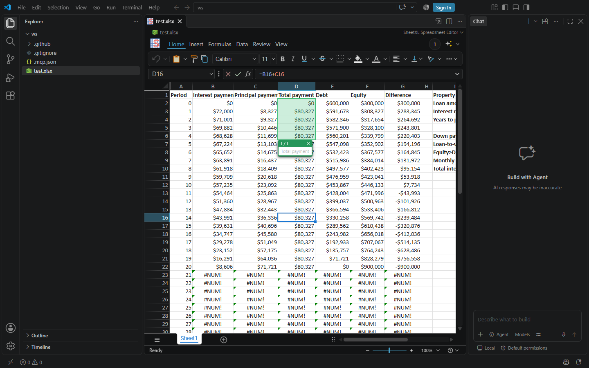
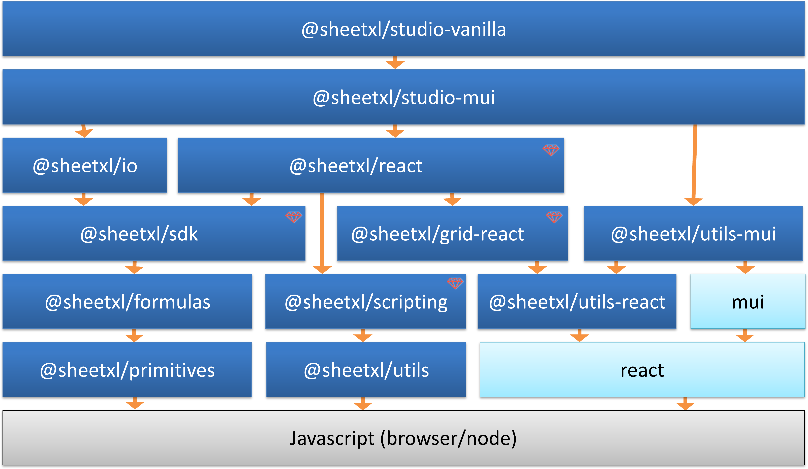

<a id="readme-top"></a>

<p align="center">
  
  
</p>

<h1 align="center">SheetXL — the agent-first spreadsheet engine</h1>

<p align="center"><b>The Excel-compatible spreadsheet engine your agents, your apps and your servers can run.</b></p>

<p align="center">
  <a href="https://demo.sheetxl.com">▶ Live demo</a> ·
  <a href="https://www.sheetxl.com/docs/guides">📘 Docs</a> ·
  <a href="https://www.sheetxl.com/docs/guides/benchmarks/performance">⚡ Benchmarks</a> ·
  <a href="https://api.sheetxl.com">🔌 API reference</a> ·
  <a href="https://www.sheetxl.com/pricing">💲 Pricing</a> ·
  <a href="https://discord.gg/NTKdwUgK9p">💬 Discord</a>
</p>

<p align="center">
  <a href="https://discord.gg/NTKdwUgK9p"></a>
  <a href="https://www.npmjs.com/package/sheetxl"></a>
  <a href="https://www.npmjs.com/package/@sheetxl/studio-mui"></a>
  <a href="https://www.npmjs.com/package/@sheetxl/studio-mui"></a>
</p>

<details>
<summary>Table of contents</summary>

* [See it running](#see-it-running)
* [Just the facts](#just-the-facts)
* [One engine, three ways in](#one-engine-three-ways-in)
  * [For agents — a plugin](#1-for-agents--a-plugin)
  * [For apps — a React component](#2-for-apps--a-react-component)
  * [For servers — a headless library and CLI](#3-for-servers--a-headless-library-and-cli)
* [Compared](#compared)
* [The engine](#the-engine)
* [License and pricing](#license-and-pricing)
* [Why SheetXL?](#why-sheetxl)
* [Roadmap](#roadmap)
* [Credits](#credits)
* [Learn more](#learn-more)

</details>

### ▶ [Try the live demo](https://demo.sheetxl.com) — the full spreadsheet in your browser, no signup

Agents can reach every system except your spreadsheets. They read the file with Python, guess at what
Excel would have calculated, and hope. SheetXL gives them the real thing: a calculation engine with
545+ Excel functions that an agent can query, change, recalculate and verify, with an audit log and
undo, on your machine. The same engine is a React component for your app and a headless library for
Node.

```bash
# No install. Ask a workbook a question from the terminal.
npx sheetxl -e "wb.getRange('Pricing!B14').getValue()" model.xlsx
```

Or paste this into Claude Code, Codex, Cursor or any agent that can run a shell:

```text
I'd like to upgrade your spreadsheet skills with SheetXL:
npx -y skills add sheetxl/skills -g --all

Then give me a quick intro to the new things you can do.
```

<!-- TODO(recording): replace with the VS Code agent clip, e.g. ./static/img/vscode-agent-demo.gif -->


*The agent highlights the cells it means and asks you in the grid, not in a sidebar.*

## See it running

Each picture opens that workbook in the live demo. Nothing to install, and every cell is editable.

<table>
  <tr>
    <td width="50%" valign="top">
      <a href="https://demo.sheetxl.com/?source=https://unpkg.com/@sheetxl/templates-workbook@latest/dist/templates-workbook/demos/sales-dashboard.sxl&title=Sales%20Dashboard">
        <picture>
          <source media="(prefers-color-scheme: dark)" srcset="https://unpkg.com/@sheetxl/templates-workbook@latest/dist/templates-workbook/demos/sales-dashboard.dark.webp?v=2026-11-10">
          
        </picture>
      </a>
      <br>
      <b>Sales dashboard.</b> 600 orders behind KPI tiles, tables, a heatmap,
      <a href="https://demo.sheetxl.com/?source=https://unpkg.com/@sheetxl/templates-workbook@latest/dist/templates-workbook/demos/sales-dashboard.sxl&title=Sales%20Dashboard#Charts">charts</a>,
      a <a href="https://demo.sheetxl.com/?source=https://unpkg.com/@sheetxl/templates-workbook@latest/dist/templates-workbook/demos/sales-dashboard.sxl&title=Sales%20Dashboard#Pivot">pivot table</a>,
      <a href="https://demo.sheetxl.com/?source=https://unpkg.com/@sheetxl/templates-workbook@latest/dist/templates-workbook/demos/sales-dashboard.sxl&title=Sales%20Dashboard#Analysis">dynamic arrays</a> and
      <a href="https://demo.sheetxl.com/?source=https://unpkg.com/@sheetxl/templates-workbook@latest/dist/templates-workbook/demos/sales-dashboard.sxl&title=Sales%20Dashboard#Performance">conditional formats</a>.
    </td>
    <td width="50%" valign="top">
      <a href="https://demo.sheetxl.com/?source=https://unpkg.com/@sheetxl/templates-workbook@latest/dist/templates-workbook/demos/mandelbrot.sxl&title=Mandelbrot">
        <picture>
          <source media="(prefers-color-scheme: dark)" srcset="https://unpkg.com/@sheetxl/templates-workbook@latest/dist/templates-workbook/demos/mandelbrot.dark.webp?v=2026-11-10">
          
        </picture>
      </a>
      <br>
      <b>Mandelbrot.</b> One formula spills 8,192 cells and a color scale paints them. Change the zoom and it redraws.
    </td>
  </tr>
  <tr>
    <td width="50%" valign="top">
      <a href="https://demo.sheetxl.com/">
        
      </a>
      <br>
      <b>Start from scratch.</b> The whole app, a blank workbook and the template gallery. Paste from
      Excel, drop in an xlsx, or type a formula.
    </td>
    <td width="50%" valign="top">
      <a href="https://storybook.sheetxl.com">
        
      </a>
      <br>
      <b>Storybook.</b> Every component on its own, with the props to try. The quickest way to see
      what you would build with.
    </td>
  </tr>
</table>

The workbooks are templates from the demo's New Workbook gallery; they live in
[sheetxl/templates-workbook](https://github.com/sheetxl/templates-workbook). More in the
[demo gallery](https://www.sheetxl.com/demos).

## Just the facts

<table>
  <tr>
    <td align="center" width="33%" valign="top">
      <h3>97%</h3>
      <b>on SpreadsheetBench</b><br>
      <sub>Verified-400. Agents reading the file with Python score 14–29%.</sub><br><br>
    </td>
    <td align="center" width="33%" valign="top">
      <h3>7× fewer</h3>
      <b>output tokens per task</b><br>
      <sub>The engine does the arithmetic, so the model does not.</sub><br><br>
    </td>
    <td align="center" width="33%" valign="top">
      <h3>&lt; 0.4 s</h3>
      <b>for a million formulas</b><br>
      <sub>Filled and calculated. Saved in about a second, in 160 MB.</sub><br><br>
    </td>
  </tr>
  <tr>
    <td align="center" width="33%" valign="top">
      <h3>545+</h3>
      <b>Excel functions</b><br>
      <sub>Dynamic arrays, LAMBDA, financials, statistics, text and dates.</sub><br><br>
    </td>
    <td align="center" width="33%" valign="top">
      <h3>120,000+</h3>
      <b>test fixtures</b><br>
      <sub>Each one checked against what Excel actually returns.</sub><br><br>
    </td>
    <td align="center" width="33%" valign="top">
      <h3>475+</h3>
      <b>shortcut keys and gestures</b><br>
      <sub>As in Excel, so your fingers already know them.</sub><br><br>
    </td>
  </tr>
</table>

Got questions about a number? Ask us on [Discord](https://discord.gg/NTKdwUgK9p).

<sub>SpreadsheetBench: our submission, October 2026; baseline figures are from the public leaderboard
(V1 Verified). Tokens: measured per task over the same 400 tasks; the agent-alone figure is derived,
and the method is on [sheetxl.com/agent](https://www.sheetxl.com/agent). The harness that scored the
benchmark is the one you install, not a private build. Engine timings and method are in the
[performance benchmarks](https://www.sheetxl.com/docs/guides/benchmarks/performance).</sub>

## One engine, three ways in

### 1. For agents — a plugin

Claude Code, Codex, Cursor or VS Code gets a spreadsheet it can calculate, check and fix. It is a
spreadsheet plugged into your agent, so the agent that already has your code and your data gets the
workbook as one more thing it can run.

* **Your AI.** Bring the subscription you already have; SheetXL never marks up tokens.
* **Your machine.** Your workbooks never leave it. No upload, no SaaS in the loop.
* **Verified, not hoped.** Every write is recalculated by a real engine and read back.
* **Reversible.** Sandbox sessions, a commit per change, undo, and an action log of what the agent did and why.

```bash
# Claude Code — the skill and the MCP server, at one version
claude plugin marketplace add sheetxl/skills
claude plugin install sheetxl@sheetxl

# Codex
codex plugin marketplace add sheetxl/skills
codex plugin add sheetxl@sheetxl

# VS Code — the grid, the engine and the MCP server. No Node, no terminal.
code --install-extension sheetxl.sheetxl-vscode --pre-release

# Any MCP client
npx -y @sheetxl/mcp
```

What is in the box:

* **The skill** — teaches the agent to query a workbook like a database and run TypeScript inside the engine. MIT.
* **The MCP server** — sessions, commits, undo and an audit log. Finds the workbooks you have open.
* **The CLI** — the same engine from a shell. What the agent runs when there is no server.
* **The VS Code extension** — a grid beside the agent, so a person stays in the loop.

[Agent quickstart →](https://www.sheetxl.com/docs/guides/getting-started/agent)

### 2. For apps — a React component

An Excel-compatible spreadsheet inside your product. Not "Excel-like": every shortcut key and drag
gesture, dynamic arrays, formatted copy/paste, charts and pivots. Real DOM, not a canvas, so every
cell is an element you can style with CSS, inspect in devtools and test like any other web UI.

```bash
# A new project, pre-configured
npm create sheetxl
```

<details>
<summary>Or add it to an existing React app...</summary>

React 19 and MUI 9 are peers.

```bash
npm install @sheetxl/studio-mui @mui/material @mui/styled-engine @mui/system @mui/utils @emotion/react @emotion/styled react react-dom
```

</details>

```javascript
import { Studio } from '@sheetxl/studio-mui';

export default function App() {
  // Studio fills its parent container.
  return (
    <div style={{ height: '600px', width: '100%' }}>
      <Studio />
    </div>
  );
}
```

Not using React? [`@sheetxl/studio-vanilla`](https://www.npmjs.com/package/@sheetxl/studio-vanilla)
is the same app, prebundled behind a plain JavaScript API.
[React guide →](https://www.sheetxl.com/docs/guides/getting-started/react)

### 3. For servers — a headless library and CLI

Pricing models, reports and reconciliations, run by your services, your schedules and your agents.
No screen, no Excel install, no LibreOffice, no network call in the loop. Node 22+.

```bash
npm install @sheetxl/sdk @sheetxl/io
```

```javascript
import { Workbook, WorkbookIO } from '@sheetxl/sdk';
import { IOPlugin } from '@sheetxl/io';

// Register the file format handlers (xlsx, csv, …) once at startup
await WorkbookIO.install(IOPlugin);

const workbook = await WorkbookIO.read('pricing-model.xlsx');
workbook.getRange('Inputs!B2').setValues([[1250]]);
const quote = workbook.getRange('Quote!B10').getValues();
await WorkbookIO.write(workbook, 'quote.xlsx');
```

The CLI is the same engine with no install. If you know `duckdb`, `sqlite3` or `psql`, you already
know its shape; where they take SQL, SheetXL takes TypeScript.

```bash
npx sheetxl book.xlsx                                   # interactive session, workbook loaded as `wb`
npx sheetxl -e "wb.getRange('A1:D9')" book.xlsx         # evaluate, print, exit
npx sheetxl -f transform.ts book.xlsx --out result.csv  # run a script, write the result
npx sheetxl book.xlsx --out book.csv                    # convert; no code needed
```


[Node guide →](https://www.sheetxl.com/docs/guides/getting-started/node) · [CLI guide →](https://www.sheetxl.com/docs/guides/getting-started/cli)

## Compared

A component for your app, a library for your server, a plugin for the agent you already run. Most
spreadsheet vendors cover one layer.

| | In your app<br><sub>A spreadsheet UI you embed</sub> | On your server<br><sub>A calculation library for Node</sub> | With your agent<br><sub>A plugin for the agent you already run</sub> |
| --- | :---: | :---: | :---: |
| **SheetXL** | ✓ | ✓ | ✓ |
| Univer | ✓ | ✓ | ✓ |
| GRID | ✓ | ✓ | ✓ |
| SpreadJS | ✓ | — | — |
| SheetJS Pro | — | ✓ | — |
| HyperFormula | — | ✓ | — |
| Coherent Spark | — | Their server | — |
| Handsontable | — | — | — |
| AG Grid | — | — | — |
| Shortcut | — | — | Their agent |
| Tracelight | — | — | Their agent |

<sub>Checked November 2026 against each vendor's public product and pricing pages. A check means a
supported product for that layer that runs where you run. "Their server" and "Their agent" mean the
vendor does it inside their own product: on their servers, or with their AI, not yours.
[The longer comparison →](https://www.sheetxl.com/docs/guides/about/landscape)</sub>

## The engine

* **Fast.** Columnar storage and vectorized calculation. Fills and calculates a million formulas in under 0.4 s. See the [benchmarks](https://www.sheetxl.com/docs/guides/benchmarks/performance).
* **Big.** 17B+ cells per workbook (defaults to Excel's limits; configurable). Rendering is virtualized, so a million rows scroll at 60 fps.
* **Excel-compatible, verified.** 545+ functions checked against Excel with 120,000+ test fixtures. Dates, percents and errors are typed values, so what you read is what you can write back.
* **Deterministic.** Same inputs, same outputs, every run. Runs unchanged in Node.js, Bun and the browser.
* **Scriptable.** A range-based TypeScript API, live scripting with no build step, and custom functions in a few lines.
* **Files in and out.** `xlsx`, `csv`, `json` and `sxl` (SheetXL's own format); `parquet` in progress. Formulas, names, formats, charts and pivots survive the xlsx round trip.


<details>
<summary><b>The full list of spreadsheet features...</b></summary>

* Dynamic arrays
* 475+ shortcut keys and gestures, as in Excel
* Formatted Copy/Paste (Compatible with Microsoft Excel and Google Sheets)
* Live Scripting (Office Scripts-style, with user-defined functions)
* Tables (Filtering, Formatting)
* Charting
* Pivot
* Sparklines
* Slicers
* Data Validation
* Conditional formatting
* Cell Styles (Themes and Formatting), Preset Cell Style Selector
* Office Theme (Color Picker, Theme Selector)
* Borders, Overflow, Word-wrap
* Merged Cells
* Multi-range selection
* Hidden, Frozen, Resizable and Auto-fit Rows/Columns
* Autofill
* Undo/Redo
* Find/Replace
* Sort
* Zoom
* Hyperlinks
* Drawings and Shapes
* Internationalization
* Mobile Friendly (Touch / Small screen accommodation)

</details>

## License and pricing

The applications, the CLI, the agent skills, the built-in formulas and the utilities are MIT, with
source in this repository and in [sheetxl/skills](https://github.com/sheetxl/skills). The core
engine, the xlsx reader/writer, the MCP server and the React toolkits are commercially licensed.
Every package and its license is listed below.

* **SheetXL for Agents** (skills, MCP server, CLI, VS Code extension) has a free tier and a paid tier, and the paid tier is free during launch. It works with your own AI subscription. Your workbooks never leave your machine; the Free and Pro tiers send usage stats to SheetXL, and Business turns that off.
* **SheetXL for Apps** and **SheetXL for Servers** are free to evaluate, watermarked outside localhost, and licensed per app for production.
* **Files are never hostage.** Workbooks always open, edit and save, on every tier, forever.

See [Pricing](https://www.sheetxl.com/pricing), [LICENSE.md](./LICENSE.md) and
[Licensing](https://www.sheetxl.com/docs/guides/licensing-pricing) for terms.

<details>
<summary><b>Every package and its license...</b></summary>



`Items marked with 💎 are commercially licensed.`

| Category     | Module                        | Description                                          | License    |
|--------------|-------------------------------|------------------------------------------------------|------------|
| Core         | @sheetxl/sdk 💎               | Headless spreadsheet API                             | Commercial |
|              | @sheetxl/formulas             | Built-in formulas                                    | MIT        |
|              | @sheetxl/formulas-extended 💎 | Extended (enterprise) formulas                       | Commercial |
|              | @sheetxl/primitives           | Low level types (Scalar, IRange)                     | MIT        |
|              | @sheetxl/scripting 💎         | Scripting engine and compiler                        | Commercial |
|              | @sheetxl/query 💎             | Workbook read surface and renderers (grep, reports)  | Commercial |
| IO           | @sheetxl/io                   | Import/export (xlsx, csv, json, sxl)                 | MIT        |
|              | @sheetxl/io-xlsx 💎           | Excel (xlsx) reader/writer                           | Commercial |
| Agents       | @sheetxl/skills               | Agent skills (markdown; ships no code)               | MIT        |
|              | @sheetxl/mcp 💎               | MCP server: sessions, commits, undo, audit log       | Commercial |
|              | sheetxl-vscode 💎             | VS Code extension: the grid beside your agent        | Commercial |
| Tools        | sheetxl                       | Command line tool (`npx sheetxl`)                    | MIT        |
|              | @sheetxl/runner               | Programmatic execution of SheetXL scripts            | MIT        |
| Applications | @sheetxl/studio-vanilla       | Framework-agnostic spreadsheet app                   | MIT        |
|              | @sheetxl/studio-mui           | Spreadsheet app powered by React/MUI                 | MIT        |
| UI Toolkits  | @sheetxl/react 💎             | Spreadsheet React UI components and hooks            | Commercial |
|              | @sheetxl/grid-react 💎        | Lightweight, standalone React data grid              | Commercial |
|              | @sheetxl/scripting-react 💎   | Monaco-based script editor and scripting UI          | Commercial |
|              | @sheetxl/scripting-mui        | MUI script workspace, toolbar, and run-script plugin | MIT        |
| Utils        | @sheetxl/utils                | Headless utilities (math, ranges, etc)               | MIT        |
|              | @sheetxl/utils-node           | Node-only utilities (terminal, environment)          | MIT        |
|              | @sheetxl/utils-react          | React UI helpers                                     | MIT        |
|              | @sheetxl/utils-mui            | MUI UI helpers (color picker, dialogs, etc)          | MIT        |

</details>

## Why SheetXL?

For 40 years Excel has been users' favorite software, and it has kept developers in a separate silo.
Users build the model in a spreadsheet. Developers get an export, a request to "put it in the app",
and a rewrite of the logic in code that starts drifting from the original the day it ships.

As an Excel user and a React developer, I always wanted my applications to *have* spreadsheet
features: the flexibility of Excel with the control of my own code. Importing and exporting data is
a broken part of nearly every business workflow. Instead of importing and exporting the data, just
import the spreadsheet.

Agents are now hitting the wall developers hit: they can read the file, but they can't run it. So
SheetXL is a library first, something you can install, script, test and run in CI, with the grid and
the agent tools built on the same API.

— Michael Ford, founder

**SheetXL's mission is to make the spreadsheet part of your stack, not the shadow IT running beside it.**

Read the full story: [Why SheetXL Exists](https://www.sheetxl.com/docs/guides/about) ·
[How we compare](https://www.sheetxl.com/docs/guides/about/landscape)

## Roadmap

Full Excel parity is expected early/mid 2027.

* Ribbon/Multi-chord shortcuts (in progress)
* RichText (in progress)
* Printing and PDF Export (in progress)
* Multithreaded calculation
* Accessibility ([WCAG 2.1](https://www.w3.org/TR/WCAG21/), in progress)
* Parquet (in progress)
* Collaboration
* VBA Macro Execution
* Google Sheets Interop

## Credits

* [Fast Formula Parser](https://github.com/LesterLyu/fast-formula-parser) (Early grammar inspiration)
* [Formula.js](https://formulajs.info) (Test cases for several financial functions)
* [Chevrotain](https://chevrotain.io) (Formula parser toolkit)
* [NumFmt](https://github.com/borgar/numfmt) by Borgar Þorsteinsson (Number format engine, vendored with patches)
* [SheetJS](https://sheetjs.com) (Compound file (CFB) container reader, adapted from `XLSX.CFB.read`)
* [Papa Parse](https://www.papaparse.com) (For CSV parsing)

## Learn more

* 💬 **[Discord](https://discord.gg/NTKdwUgK9p)** - Get help and connect with the team.
* 🗣️ **[GitHub Discussions](https://github.com/sheetxl/sheetxl/discussions)** - Questions, ideas, and show-and-tell.
* 📘 **[Developer Docs](https://www.sheetxl.com/docs/guides)** - Guides and tutorials.
* 🔌 **[API Reference](https://api.sheetxl.com)** - Detailed documentation for all packages.
* 👀 **[Live Demo Gallery](https://www.sheetxl.com/demos)** - A showcase of interactive examples.
* 🖼️ **[Storybook](https://storybook.sheetxl.com)** - Explore and test individual UI components.
* 🌐 **[Website](https://www.sheetxl.com)** - Agents, Apps, Servers and pricing.
* ❓ **[FAQ](./FAQ.md)** - Frequently asked questions.
* 🤝 **[Contributing](./CONTRIBUTING.md)** - How to get involved.
* 🔒 **[Security Policy](./SECURITY.md)** - Reporting vulnerabilities.
* 📦 **[Changelog](https://www.sheetxl.com/changelog)** - Release notes and changelog.
