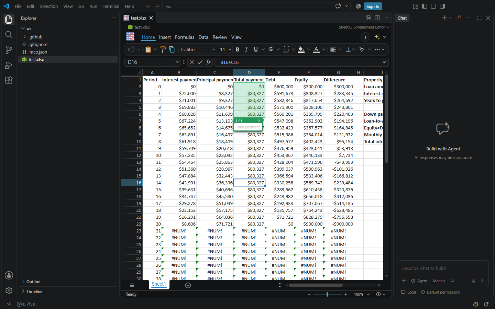

import Tabs from '@theme/Tabs';
import TabItem from '@theme/TabItem';

import { AgentPromptCode } from '@site/src/components/AgentPrompt';

# Getting Started in VS Code

<div style={{ display: 'flex', justifyContent: 'center', marginBottom: 32 }}>
  <div
    style={{
      display: 'flex', alignItems: 'center', justifyContent: 'center', gap: 12,
      width: 180, height: 68,
      background: '#ffffff', color: '#1f1f1f',
      fontSize: 22, fontWeight: 600,
      borderRadius: 16, boxShadow: '0 4px 24px rgba(0,0,0,0.08)'
    }}
  >
    
    <span>VS Code</span>
  </div>
</div>

The SheetXL extension (**AI Spreadsheet** on the Marketplace) turns VS Code into a spreadsheet
editor your AI agent can see. Open an
`.xlsx` file and it renders in the editor. Open the chat and the agent works on the same
workbook: it reads it, changes it, highlights the cells it is talking about, and asks you
questions in the grid.

Five steps, about three minutes. Each step shows what to click and, for agents or anyone who
prefers a terminal, the command that does the same thing.



## 1. Get VS Code

Download it from [code.visualstudio.com/download](https://code.visualstudio.com/download) for
Windows, macOS, or Linux, and run the installer. If you already have VS Code, skip ahead.

```sh
# Windows (winget) · macOS (Homebrew)
winget install Microsoft.VisualStudioCode
brew install --cask visual-studio-code
```

## 2. Install SheetXL

<Tabs
  defaultValue="vscode"
  values={[
    {label: 'vscode', value: 'vscode'},
    {label: 'agent', value: 'agent'},
    {label: 'terminal', value: 'terminal'}
  ]}>
  <TabItem value="vscode">

<a className="button button--primary button--lg" href="vscode:extension/sheetxl.sheetxl-vscode">Install in VS Code</a>

<p />

The button opens VS Code on the extension's page. Click **Install** there. If the button does
nothing, open the Extensions view (`Ctrl+Shift+X` / `⇧⌘X`), search for **SheetXL**, and install it
from there, or use the
[Marketplace page](https://marketplace.visualstudio.com/items?itemName=sheetxl.sheetxl-vscode).

  </TabItem>
  <TabItem value="agent">

Paste this into an agent that has a terminal (Claude Code, Codex, Cursor, …):

<AgentPromptCode id="vscode" />

  </TabItem>
  <TabItem value="terminal">
```sh
code --install-extension sheetxl.sheetxl-vscode
```
  </TabItem>
</Tabs>

That is the whole install. The extension brings its own spreadsheet engine and its own MCP server,
and runs them with VS Code's built-in runtime. You do not need Node, npm, or a terminal.

## 3. Open a spreadsheet

**File → Open File…** and pick an `.xlsx` file, or drag one onto the VS Code window. It opens in
the SheetXL editor. If you opened a folder, the file list on the left works too.

```sh
code my-model.xlsx
```

Any `.xlsx` works, and so do `.sxl` and `.csv` files. Try one of your own, or download a sample from the
[demos](https://www.sheetxl.com/demos).

## 4. Open the chat

Click the chat icon in the title bar, or press `Ctrl+Alt+I` (`⌃⌘I` on macOS).

- **GitHub Copilot** is built into VS Code and finds SheetXL on its own. The free tier needs a
  GitHub sign-in; VS Code prompts for it the first time you open the chat. Pick **Agent** mode
  in the chat's mode selector so Copilot can use tools.
- **Claude Code** users install the
  [Claude Code extension](https://marketplace.visualstudio.com/items?itemName=anthropic.claude-code)
  and open its chat instead. Add the SheetXL plugin once, in that chat:
  `/plugin marketplace add sheetxl/skills` then `/plugin install sheetxl@sheetxl`. The plugin's
  MCP server finds the workbooks you have open in this window.
- **Any other MCP client** can do the same with the server from npm, `npx -y @sheetxl/mcp`. It
  finds this window's open workbooks on its own. The [MCP guide](./mcp) has the setup for each
  client.

## 5. Ask

Type this into the chat:

```text
Can you tell me about this spreadsheet?
```

The agent connects to SheetXL, reads the open workbook, and answers. From there, ask it to do
things: "add a column that computes the margin", "find every cell that references D16", "why is
row 23 showing #NUM!". When it changes something, the change is a commit you can undo. When it
wants you to look at cells, they light up in the grid.

## What the agent can do

- Read any range, formula, or format, and search cells.
- Change the workbook by writing TypeScript against the SheetXL API. Every change is undoable.
- Highlight ranges and ask you a question in the grid, then wait for your answer.
- Work in a sandbox copy before touching your file.

## Which path is which

The **extension** is everything a Copilot user needs: the grid, the MCP server, and the agent's
reference material, with nothing else to install. It writes nothing into your folder for this.

The **Claude Code plugin** (`/plugin install sheetxl@sheetxl`) is how Claude Code reaches the
grid, and the same plugin, or the **skills install** (`npx -y skills add sheetxl/skills -g --all`),
serves agents working in a terminal without it, as described in the
[agent quickstart](./agent). The plugin's server finds whatever this window has open, so
running the extension and the plugin together is the normal setup for Claude Code.

## Free during launch

The SheetXL Agent is free during launch, with no key and no sign-in. Each build runs for a period from its release
date, then asks to be updated; VS Code's automatic extension updates keep you current.
