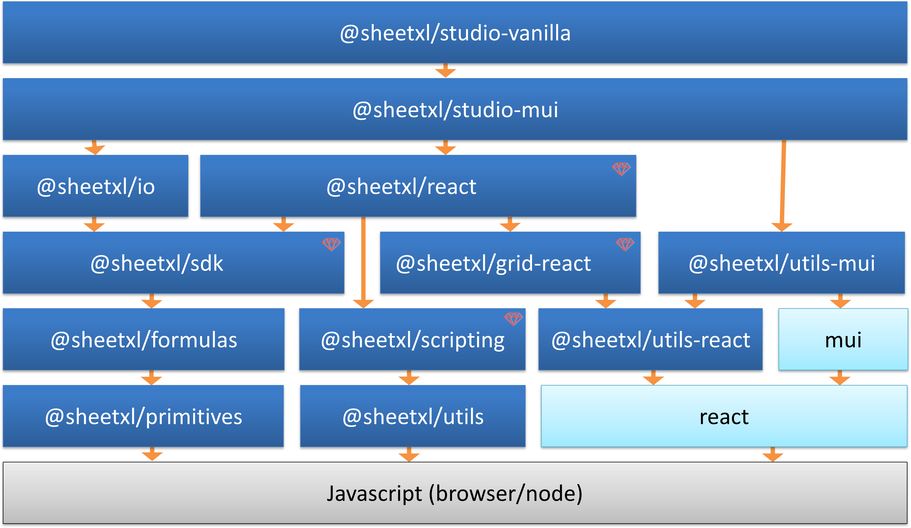

SheetXL is layered so you can use the complete studio or compose exactly what your application needs.

Each package has a single clear purpose and works independently or as part of the full stack.

Package names link to their [API reference](https://api.sheetxl.com) where one is published.

### Core

A fully embeddable spreadsheet engine and API. Think Office Scripts meets NumPy: a complete workbook model,
vectorized calculations, and scripting, without the server.

| Package | Description | License |
|---|---|---|
| [@sheetxl/sdk](https://api.sheetxl.com/modules/_sheetxl_sdk.html) | High-performance headless spreadsheet engine with a full workbook API, calculation pipeline, and scripting support. | Commercial |
| [@sheetxl/primitives](https://api.sheetxl.com/modules/_sheetxl_primitives.html) | Core TypeScript interfaces and types (`Scalar`, `IRange`) shared by the SDK and by functions. | MIT |

### Formulas

The function libraries the engine calculates with.

| Package | Description | License |
|---|---|---|
| @sheetxl/formulas | The Excel-compatible built-in function library, authored using the same public API as UDFs, making them a clean reference for writing your own. | MIT |
| @sheetxl/formulas-extended | Specialist financial modeling and statistical forecasting functions. | Commercial |

### UI

Ready-to-use components for embedding spreadsheets in your application.

| Package | Description | License |
|---|---|---|
| [@sheetxl/studio-mui](https://api.sheetxl.com/modules/_sheetxl_studio-mui.html) | Complete spreadsheet application delivered as a React component using Material-UI. Embed a full spreadsheet in minutes. | MIT |
| [@sheetxl/studio-vanilla](https://api.sheetxl.com/modules/_sheetxl_studio-vanilla.html) | Plain JavaScript wrapper around Studio-MUI for integration into non-React applications. | MIT |
| [@sheetxl/react](https://api.sheetxl.com/modules/_sheetxl_react.html) | Core React spreadsheet components used by Studio-MUI (cells, sheets, toolbars, dialogs). | Commercial |
| @sheetxl/grid-react | Virtualized React grid with a layer-based architecture. Compose selection, editing, tooltips, and custom overlays as React components. | Commercial |

All UI packages are built entirely on the public `@sheetxl/sdk` API. Nothing is hardwired. Anything the built-in UI can do, your code can do too.

### I/O

Read and write workbooks in different formats.

| Package | Description | License |
|---|---|---|
| [@sheetxl/io](https://api.sheetxl.com/modules/_sheetxl_io.html) | Import and export workbooks in SXL, JSON, and CSV formats. | MIT |
| [@sheetxl/io-xlsx](https://api.sheetxl.com/modules/_sheetxl_io-xlsx.html) | Import and export workbooks in Excel (.xlsx) format. | Commercial |

### Scripting

Extend SheetXL with custom functions and automation, and give your users an editor to write them in.

| Package | Description | License |
|---|---|---|
| @sheetxl/scripting | TypeScript/JavaScript compilation engine for authoring macros and user-defined functions (UDFs). | Commercial |
| [@sheetxl/scripting-react](https://api.sheetxl.com/modules/_sheetxl_scripting-react.html) | Monaco-based script editor and scripting UI for React. | Commercial |
| [@sheetxl/scripting-mui](https://api.sheetxl.com/modules/_sheetxl_scripting-mui.html) | MUI script workspace, toolbar, and run-script plugin. Drops into Studio-MUI. | MIT |
| @sheetxl/runner | Library for executing scripted workbook transformations programmatically from Node.js. | MIT |

### Tooling

Operate SheetXL from the terminal.

| Package | Description | License |
|---|---|---|
| sheetxl | Command-line interface to the SheetXL SDK. Interact with workbooks, run scripts, and automate transformations from the terminal. | MIT |
| [@sheetxl/query](https://api.sheetxl.com/modules/_sheetxl_query.html) | Workbook read surface and renderers (grep, reports) behind the CLI's inspection commands. | Commercial |

### AI

Give an AI agent a real spreadsheet engine. See [Quick Start (with Agent)](../20-getting-started/0-agent.mdx).

| Package | Description | License |
|---|---|---|
| @sheetxl/mcp | MCP server that exposes SheetXL spreadsheet operations as tools and resources for AI agents. | Commercial |
| [sheetxl/skills](https://github.com/sheetxl/skills) | Agent skills and reference documentation, version-matched to the engine that executes agent code. | MIT |

### Utilities

Shared building blocks used across the ecosystem.

| Package | Description | License |
|---|---|---|
| [@sheetxl/utils](https://api.sheetxl.com/modules/_sheetxl_utils.html) | Headless utility functions used internally across SheetXL packages. | MIT |
| [@sheetxl/utils-node](https://api.sheetxl.com/modules/_sheetxl_utils-node.html) | Node-only utilities (terminal presentation, environment reporting, tool logging). | MIT |
| [@sheetxl/utils-react](https://api.sheetxl.com/modules/_sheetxl_utils-react.html) | Framework-agnostic React utilities (movable panels, keystroke management, etc.). | MIT |
| [@sheetxl/utils-mui](https://api.sheetxl.com/modules/_sheetxl_utils-mui.html) | MUI-based utility components (color pickers, etc.) usable in any React application. | MIT |

* [React](https://react.dev/) and [@mui/material](https://mui.com/core/) are 3rd party dependencies.
